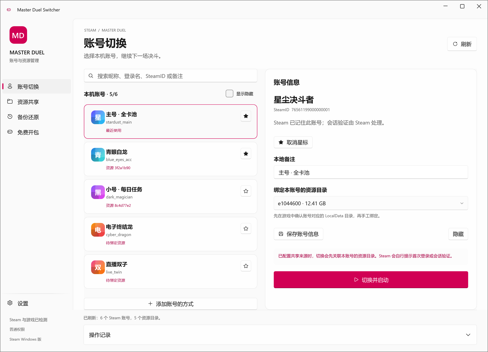
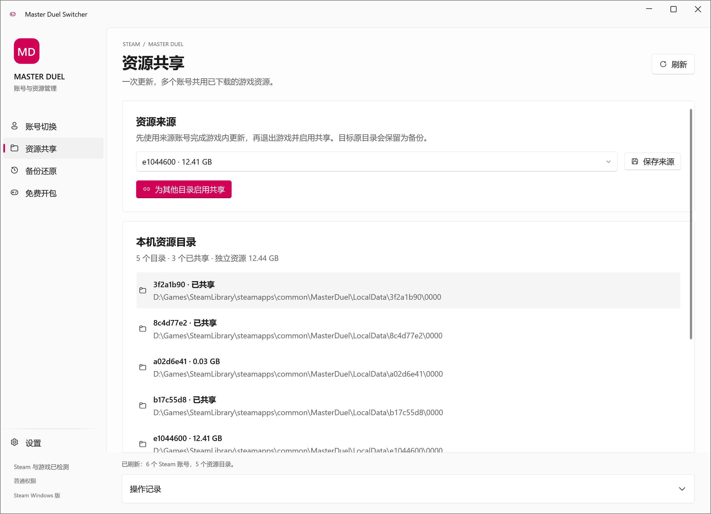
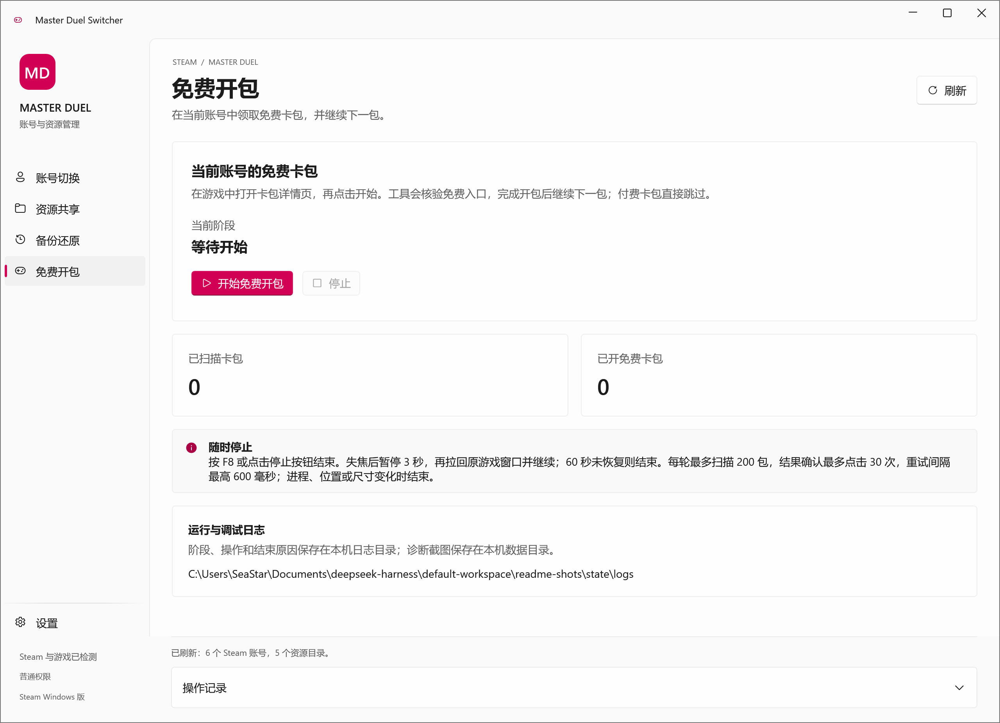
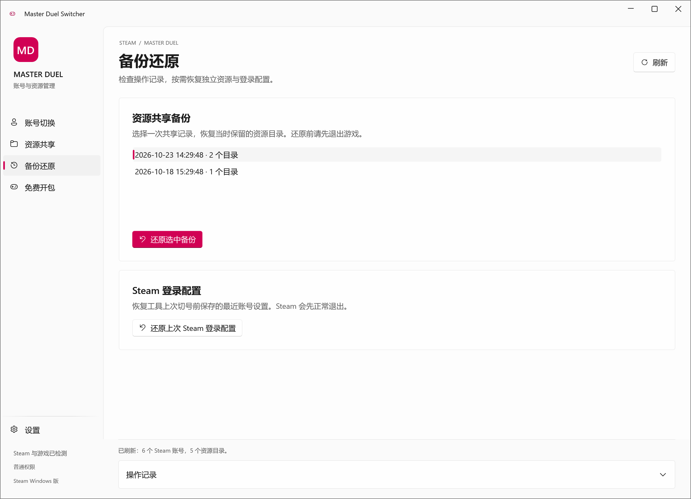
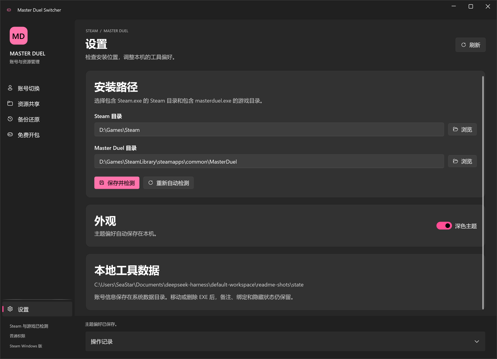
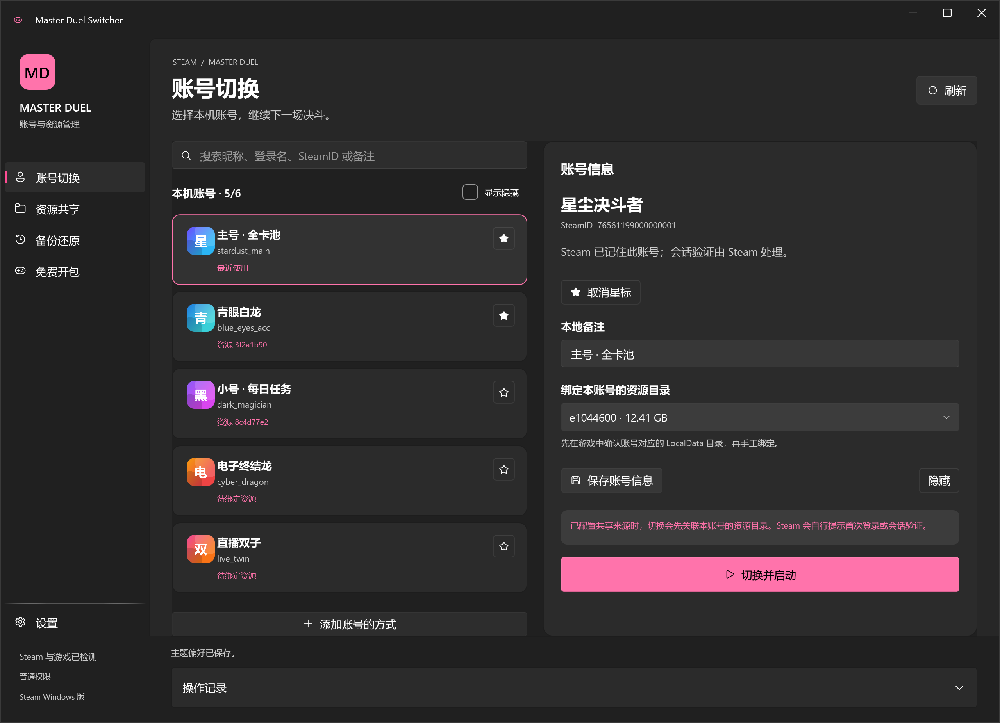
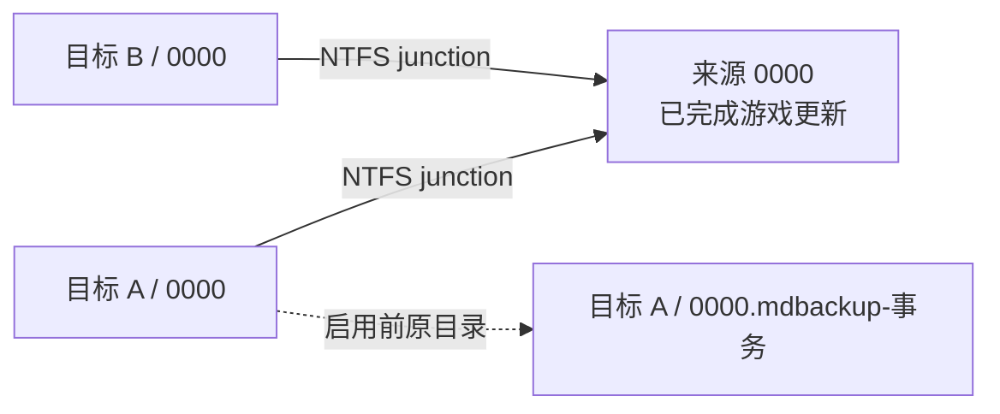
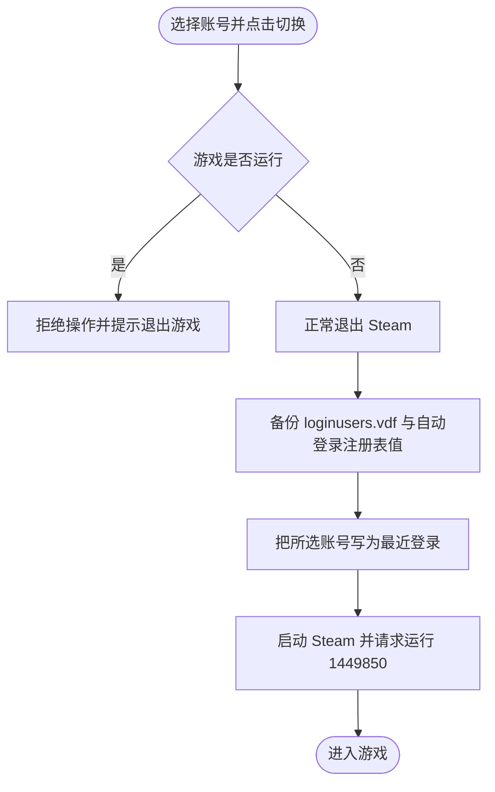

<p align="center">
  
</p>

<p align="center">
  
  
  
  
  
  
</p>

<p align="center">
  <b>Steam 版 Master Duel 换号 · 游戏资源共享 · 免费卡包自动领取</b><br>
  <sub>C# / WPF / WPF UI 的 Fluent 桌面工具，只操作登录选择与 <code>0000</code> 目录链接，不接管 Steam 凭据</sub>
</p>

---

## 这是什么

本机有多个 Steam 账号时，Master Duel 会为每个账号各下载一整套游戏资源，占用空间、更新反复。
**Master Duel Switcher** 让这些账号共用同一份已下载资源：只保留一份 `LocalData/<账号目录>/0000`，其余账号用 NTFS junction 指向它；工具负责换号、启动游戏、记录每一次目录替换，并能在需要时逐条还原。
在此基础上，它还能在当前账号里核验“免费”入口，自动完成免费卡包开包并继续下一包。

- **只做三件事**：换号、资源复用、免费开包。没有账号批量登录、没有代充、没有第三方资源下载。
- **每一步可回滚**：任何目录替换先写事务清单、再移动目录；还原只删除本工具创建的链接。
- **不接触凭据**：不读取、不保存 Steam 密码与 Steam Guard 密钥，登录验证始终由 Steam 提示并完成。

## 界面

主界面为官方 WPF UI 的 Fluent 导航布局：左侧是账号切换、资源共享、备份还原、免费开包与设置，右侧是当前页内容，底部固定显示发现状态、权限与操作记录。

<p align="center">
  
</p>

| 资源共享 | 免费开包 |
| :---: | :---: |
|  |  |

| 备份还原 | 设置（深色主题） |
| :---: | :---: |
|  |  |

<p align="center">
  
</p>

> 以上截图由工具自身窗口按 2 倍像素渲染，账号、头像、目录与事务均为合成演示数据。

## 功能

### 账号切换

- 自动发现 Steam 安装、游戏库与本机记住的账号；可在设置页手动覆盖 Steam 与游戏路径。
- 备注、隐藏、星标与即时搜索：昵称、登录名、SteamID、备注均可匹配；支持忽略大小写的有序字符模糊匹配与空格分词，多个关键词需同时命中。
- 列表排序固定为「星标 → Steam 最近使用 → Steam 记录的登录时间 → 名称 / SteamID」，搜索时保留该顺序。
- 左侧账号列表独立虚拟化滚动，搜索栏与右侧详情保持固定；未保存的备注与资源绑定在筛选、排序后仍然保留。
- 头像优先读取 Steam 本地缓存，其次从公开社区资料获取并缓存；4 项并发、每项 8 秒预算，取不到或解码失败时回退为名称首字。
- 「切换并启动」会先正常退出 Steam，备份登录配置后把所选账号写成最近登录，再由 Steam 启动 Master Duel。

### 资源共享

- 只处理 `LocalData/<八位十六进制>/0000`；`LocalSave` 与整个账号目录不参与共享。
- 启用共享前，为每个目标先写入完整事务清单（意图落盘），再把原目录移动到 `0000.mdbackup-<事务标识>`，最后安装指向来源的 junction。
- 来源账号更新后，所有已绑定账号立即复用更新后的资源；只有 Konami 发布全新资源时才需要再下载一次。
- 目标已被其他工具替换、存在未还原事务或路径被文件占用时，工具报告冲突并保留现场，不覆盖。

### 备份与还原

- 「备份还原」列出每次共享事务，可逐条还原：只删除本事务创建且仍指向预期来源的链接，并把原目录放回原位。
- 手动删除过链接与旧备份时可显式「修复失效共享」：保留当前目录为新备份，把旧清单原样归档到 `resource-backups/invalid-history`，再重新建立共享。
- 「还原上次 Steam 登录配置」恢复该次换号前的登录配置与自动登录注册表值，执行时同样先正常退出 Steam。

### 免费开包

在游戏内打开某个卡包的详情页后开始，工具会：

1. 请求激活游戏窗口，取得前台后识别免费入口、免费购买确认、开包动画与结果确认，随后切到下一包。
2. 详情页要求在同一行、同一连续黄色按钮上同时识别到「免费」和「1 包」，并由 Windows 中文 OCR 复核按钮费用文字；新版单行免费按钮同样支持。
3. 购买前重新读取弹窗费用行，要求明确免费短语，同时排除宝石费用文字、余额扣减与弹窗内宝石图标；两次实时截图都通过才点击。
4. 付费卡包只切换下一包；未知确认界面、标题变化无法复核、未核验免费弹窗时立即停止。
5. 按 **F8** 或点停止按钮随时结束；失焦、隐藏或最小化后暂停 3 秒并主动拉回原游戏窗口，60 秒未恢复则结束；每轮最多扫描 200 包，结果确认最多点击 30 次（间隔 200 → 400 → 600 毫秒封顶）。
6. 标题以 OCR 精确核验身份，回到首个标题才结束一轮；相同标题的动态卡图变化视为同一包。模板支持相同界面布局的缩放，内嵌图像来自真实游戏截图。

识别依赖 Windows 内置简体中文 OCR 模型（离线，无需额外下载模型），系统需 Windows 10 2004 或更新并安装简体中文语言功能的文字识别组件；缺少组件时日志会给出安装提示并结束任务。
运行阶段、识别置信度、点击坐标与窗口句柄等写入 Debug 日志，异常画面保存在 `free-pack-diagnostics`（最多 5 张）。

### 界面与工程

- 五个独立 Page 与对应 ViewModel，通过官方 `NavigationView` 和依赖注入页面服务导航；Shell 只负责外框。
- MVVM + DI：Core 承担目录事务、SQLite、Steam 集成、OCR 与 OpenCV 识别；View 不承载业务逻辑。
- 官方 Fluent 中性明暗主题与系统强调色，所有通知与确认使用官方 `ContentDialog`，文件夹选择使用系统对话框。
- 覆盖率门槛为自写生产代码 **100% 行与分支**，由 `scripts/Test-Coverage.ps1` 串行执行含真实窗口的 App 测试并判定；测试使用临时数据库、临时目录与隔离的系统边界，不登录或切换真实 Steam 账号。

## 快速开始

### 环境要求

| 项目 | 要求 |
| --- | --- |
| 系统 | Windows 10 2004 / Windows 11，x64 |
| 运行时 | 发布包为自包含单文件，无需另装 .NET；从源码构建需 .NET 10 SDK |
| 磁盘 | 游戏所在磁盘为 NTFS（共享依赖目录链接） |
| 权限 | 标准 UAC 管理员启动（创建目录链接与写注册表） |
| 游戏 | Steam 版 Master Duel，账号已在本机登录并记住 |

### 首次配置

1. 解压发布包并打开 `MasterDuelSwitcher.exe`，在 UAC 确认提示中选择“是”。
2. 在「设置」检查自动发现的 Steam 目录与游戏目录。游戏目录应包含 `masterduel.exe` 和 `LocalData`，未检测到时手动选择。
3. 每个 Steam 账号先在 Steam 正常登录一次并勾选记住登录。新账号启动游戏到开始下载时退出，使游戏生成自己的 `LocalData` 账号目录。
4. 在「资源共享」选中已经完成游戏更新的账号资源作为来源并保存。各账号请使用相同的游戏语言与资源版本。
5. 回到「账号」，为每个 Steam 账号绑定正确的八位资源目录。目录与 SteamID 的对应关系由你确认，查看新账号启动前后新增的目录即可定位。
6. 在「资源共享」点击「为其他目录启用共享」，完成后回到「账号」选择账号并点击「切换并启动」。

### 换号

- 先正常关闭 Master Duel，再点击「切换并启动」；工具会退出 Steam、写入登录选择并重新启动游戏。
- 首次登录、会话过期或 Steam Guard 验证由 Steam 提示，照常完成即可。
- 工具只修改 Steam 登录选择配置与 `0000` 的目录链接，账号目录与 `LocalSave` 分别保留。

### 免费开包

1. 在游戏中进入当前账号的卡包详情页，使用简体中文界面并保持游戏窗口可见。
2. 打开「免费开包」页点击开始，工具会在取得游戏前台后开始识别；已打开购买弹窗时请先取消回到详情页。
3. 需要中断时按 F8 或点击停止按钮；页面显示当前阶段、扫描数与已核验的开包数。

## 本地数据

所有状态位于系统数据目录（可用 `--state-dir <目录>` 改为便携位置），删除或移动 EXE 不会丢失账号备注与绑定：

| 内容 | 位置 |
| --- | --- |
| 账号与偏好数据库 | `%LOCALAPPDATA%\MasterDuelSwitcher\accounts.db` |
| 头像缓存 | `…\avatars\<SteamID>.png` |
| 资源事务清单 | `…\resource-backups\<事务>.json`（失效历史在 `invalid-history`） |
| Steam 登录备份 | `…\steam-login-backups\<事务>\` |
| 运行 / 调试日志 | `…\logs\run-<日期>.log`、`debug-<日期>.log`，5 MiB 滚动，各保留 14 份 |
| 免费开包诊断截图 | `…\free-pack-diagnostics\`（最多 5 张） |

日志只记录阶段、计数、坐标与异常，不写入 Steam 密码、令牌、VDF 正文或账号备注。

## 工作原理



换号时按以下顺序执行，任何一步失败都会还原已完成的修改：



## 常见情况

| 现象 | 处理 |
| --- | --- |
| 未发现账号 | 在此 Steam 安装中登录并记住账号后点击刷新 |
| 未发现游戏 | 在「设置」手动选择包含 `masterduel.exe` 的游戏目录 |
| 目录权限错误 | 确认游戏所在磁盘为 NTFS、当前用户可写，并在 UAC 中允许管理员启动 |
| 仍出现大包下载 | 核对账号绑定、来源是否已完成更新、各账号语言是否一致；先停止下载与游戏再检查共享状态 |
| 切号启动后仍是原账号 | 完成 Steam 的登录提示，并核对账号是否记住登录及目录绑定；启动结果与登录结果分别确认 |
| 想撤销一次共享 | 在「备份还原」选中该事务还原；链接已被第三方替换时会报告冲突并保留现场 |
| 免费开包立即停止 | 确认界面为简体中文、从卡包详情页开始，并已安装简体中文 OCR 语言组件 |

## 构建与验证

需要 .NET 10 SDK 与 Windows。运行全量测试前请正常退出 Master Duel（进程保护测试会在临时目录启动并关闭自有进程夹具，不会触碰正在运行的真实游戏）。

```powershell
dotnet restore MasterDuelSwitcher.sln
pwsh -File scripts/Test-Coverage.ps1      # 串行执行含真实 WPF 窗口的 App 测试，按 100% 行/分支阈值判定
dotnet build MasterDuelSwitcher.sln -c Release
pwsh -File scripts/Publish.ps1            # 输出 artifacts\publish\win-x64 自包含单文件
```

发布包内含 `MasterDuelSwitcher.exe`、`使用说明.md`（连同 `docs/images` 界面截图）、`THIRD-PARTY-NOTICES.md` 与 `licenses`；EXE 内嵌 `requireAdministrator` 与 PerMonitorV2 清单。

## 项目结构

| 目录 | 说明 |
| --- | --- |
| `src/MasterDuelSwitcher.App` | WPF UI 外壳、五个 Page 与 ViewModel、工作区与主题服务 |
| `src/MasterDuelSwitcher.Core` | Steam 发现与切换、VDF 解析、SQLite、资源事务、OCR 与 OpenCV 识别 |
| `tests/MasterDuelSwitcher.Tests` | Core、资源事务、识别、SQLite 与日志的单元及集成测试 |
| `tests/MasterDuelSwitcher.App.Tests` | App 层 ViewModel、命令与 WPF 适配测试 |
| `tests/MasterDuelSwitcher.UiProbe` | 打开真实 WPF 窗口验证导航、布局与渲染并输出截图 |
| `docs` | 设计、实现计划与逐阶段验收记录；界面截图在 `docs/images` |
| `scripts` | 覆盖率验证与发布脚本 |

## 依赖与许可

| 依赖 | 版本 | 许可 |
| --- | --- | --- |
| [WPF UI](https://github.com/lepoco/wpfui) | 4.3.0 | MIT |
| [OpenCvSharp](https://github.com/shimat/opencvsharp) / OpenCV | 4.13.0 | Apache-2.0 |
| Microsoft.Data.Sqlite | 10.0.10 | MIT |
| SQLitePCLRaw.bundle_e_sqlite3 | 2.1.13 | Apache-2.0 |
| Serilog / Serilog.Sinks.File | 4.4.0 / 7.0.0 | Apache-2.0 |
| .NET 10 Windows Desktop Runtime | 10.0.10 | MIT |

版权与许可证原文见 [THIRD-PARTY-NOTICES.md](THIRD-PARTY-NOTICES.md) 与 `licenses` 目录，随发布包一并提供。

## 说明

- 本工具与 Konami、Valve 无隶属关系，仅在本机修改 Steam 登录选择与游戏资源目录链接。
- 不处理 Steam 密码、Steam Guard 密钥或任何账号凭据；登录状态始终由 Steam 管理，发布包不含用户账号数据。
- 请自行确认使用方式符合游戏与平台的服务条款；界面截图使用合成演示数据，不包含真实账号信息。
